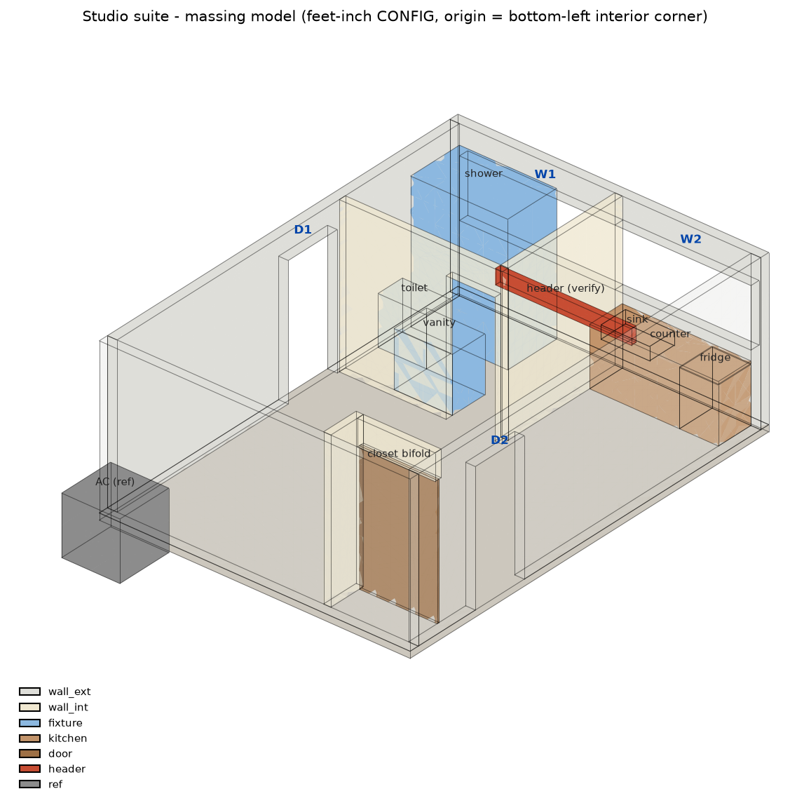
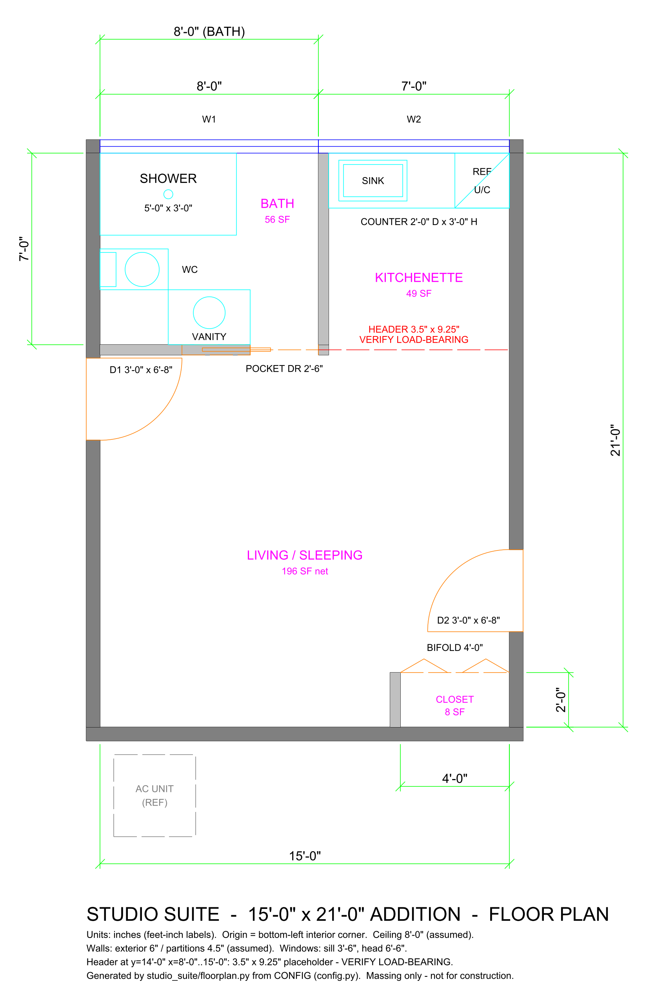

# Studio Suite: a room addition modeled in Python with CadQuery

By Brandon Warrell (William Brandon Warrell), graphic designer in Palmetto, FL. Portfolio: [brandonwarrell.com](https://www.brandonwarrell.com)

My family is planning a 15' × 21' addition that will become a studio suite: a bathroom, a kitchenette along one wall, a closet, two windows, two exterior doors and a pocket door. Instead of drawing it by hand, I modeled it in code so I can change one number and rebuild everything.



## What it does

Every dimension lives in one Python dict, `CONFIG`, in **feet**. Running the build turns that into:

| File | What it is |
|---|---|
| `studio_suite.step` | the whole model, one named part per element, units tagged as inches |
| `studio_suite.stl` | the whole model as one mesh |
| `studio_suite.glb` | for Unreal Engine 5: a separate named mesh per element (`wall_ext_top`, `fx_shower`, ...) |
| `studio_suite_zup_cm.glb` | the same meshes in literal Z-up centimeters, for tools that want raw coordinates |
| `floorplan.dxf` | 2D plan with layers for walls, doors, windows, fixtures and real dimension entities |
| `floorplan.svg`, `plan.png` | the same plan, rendered from the DXF |
| `iso.png` | a quick iso view with the camera-facing walls faded so you can see inside |



## How it works

```
studio_suite/
  config.py      CONFIG dict (all values in feet) + ASSUMPTIONS   <- edit this one
  layout.py      turns CONFIG into boxes in inches + runs the layout checks (no CadQuery)
  model.py       3D build in CadQuery + STEP / STL / GLB / iso.png exports
  floorplan.py   2D plan -> floorplan.dxf, then SVG and PNG from that DXF
  build.py       runs everything, writes ./output, prints a summary table
```

- **Origin** is the bottom-left interior corner at floor level. X runs along the 15' wall, Y along the 21' wall, Z is up.
- **"auto" keys.** Values that should follow another dimension (the kitchenette's ends, the header's position, the pocket door's edge) are set to `"auto"`. Change the room width and everything hanging off it moves too. `build.py` prints every resolved value.
- **Checks before building.** The build stops on real layout errors: fixtures outside their room, overlapping fixtures, an opening running off a wall. It warns about things worth a second look, like toilet clearances or a partition landing on a window.
- **Assumptions are labeled.** Anything that's a guess rather than a value from the sketch (8' ceiling, 6" exterior walls, header size) sits in `ASSUMPTIONS` and gets printed next to its current value.

## Run it

```bash
pip install cadquery ezdxf trimesh matplotlib numpy
python -m studio_suite.build
```

A full build takes about 5–10 seconds. The floor plan alone doesn't need CadQuery: `python -m studio_suite.floorplan`.

Tested on Windows 10 with Python 3.14.5, cadquery 2.8.0 (cadquery-ocp 7.9.3), ezdxf 1.4.4, trimesh 5.0.0, matplotlib 3.11.1 and numpy 2.4.4.

**Known issue:** cadquery-ocp 7.9.3 on Python 3.14 can crash while the interpreter shuts down, after every file is written. `build.py` ends with `os._exit()` so the exit code still reflects the real build result.

## Unreal Engine 5

Import `output/studio_suite.glb` with the default Interchange glTF settings. The room arrives at true size, Z-up, one static mesh per element.

## Important

This is a **massing model** for planning and visualization. It is not a construction document. Structural sizes (like the header over the kitchenette opening) are placeholders until an engineer reviews them for the permit.

## Credits

I wrote this with help from an AI coding assistant (Claude). The room layout comes from our family's sketch.
